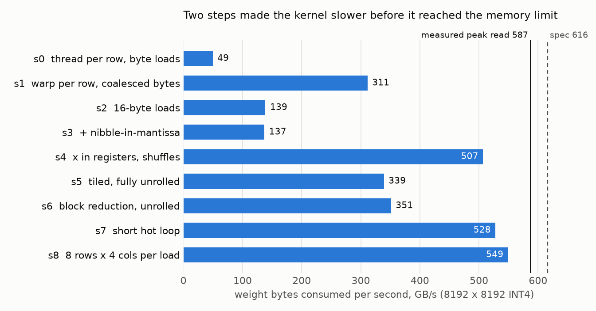
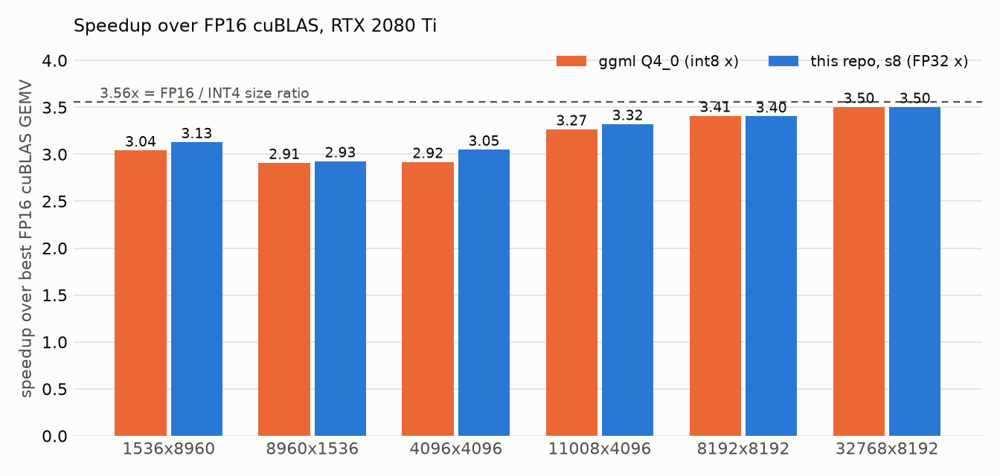
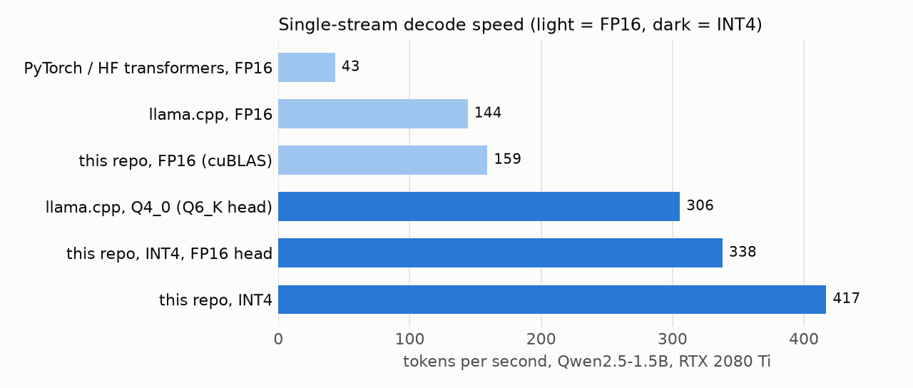
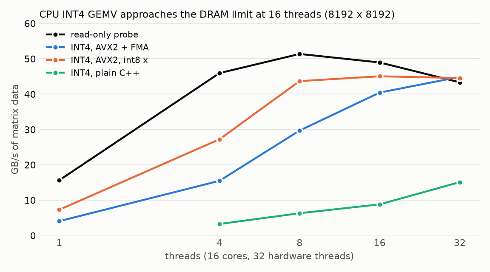

# INT4 matrix-vector kernels: CUDA and AVX2

When a language model generates text one token at a time, almost all of the time goes into
matrix-vector products (GEMV), and those are limited by how fast the weights can be read from
memory. This repo builds an INT4 GEMV for that job, one measured step at a time, for an NVIDIA GPU
(C++/CUDA) and for a CPU (C++, AVX2 + FMA), and then uses the GPU kernel to run Qwen2.5-1.5B.

Machine: one RTX 2080 Ti (11 GB, Turing, driver 580.178.04), Threadripper 1950X (16 cores, AVX2),
CUDA 12.8, g++ 13.3. All numbers below are generated from `results/raw/` by `scripts/report.py`;
the full tables are in [results/tables.md](results/tables.md).

## Results

| | result |
|---|---|
| GPU memory limit | 616 GB/s on the spec sheet, **587 GB/s measured** peak read |
| Final kernel (`s8_octet`) | **98% of measured peak read** on 32768x8192 (574 GB/s), 94% on 8192x8192, 81% on 4096x4096 |
| vs FP16 cuBLAS (best of 6 routes per shape) | **2.9x to 3.5x** faster, geometric mean **3.2x**; the FP16/INT4 size ratio, 3.56x, is the ceiling |
| vs llama.cpp Q4_0 CUDA kernel | equal within 4% (geometric mean 1.02x), but with FP32 x; llama.cpp's int8 x gives about 10^4 times more numerical error (5e-4 vs 3e-8) |
| vs the naive kernel (`s0`) | 11x to 50x, geometric mean 18x |
| CPU AVX2 INT4 | **6.3x** faster than FP32 (the better of OpenBLAS and hand-written AVX2) on 8192x8192, 87% of measured DRAM bandwidth |
| Qwen2.5-1.5B decode | **417 tok/s** INT4 vs **159 tok/s** FP16 cuBLAS in the same engine (**2.6x**), at 10.5% higher perplexity; 338 tok/s (2.1x) at 6.3% higher with an FP16 output head |






## Format

32 consecutive weights of a row share one FP16 scale: `w = scale * q`, `q` in [-8, 7], stored as the
unsigned nibble `q + 8`. That is 18 bytes per 32 weights, 0.5625 bytes per weight (FP16 is 2). The
numbers are the same as ggml's Q4_0; the memory layout is different and changes between steps.

## How it was measured

- One pass runs the GEMV on enough separate copies of the matrix to cover at least 1 GB (GPU) or
  512 MB (CPU), so nothing is reused from the 5.5 MB L2 or the 32 MB L3. Decode does the same thing
  when it walks through its layers.
- GPU passes are queued back to back and timed with CUDA events, so launch gaps (about 2 us each) are
  included. Single-call latency is recorded separately.
- 0.25 s of warm-up, then at least 30 timed passes. The whole suite ran in 3 separate processes; the tables
  use the median of the three medians. For `s8_octet` the three processes agree to within 0.7%.
- SM clock, memory clock, temperature, power and throttle reasons are sampled every 20 ms and stored with
  each record. The card ran at its 300 W power limit, 1860-2010 MHz, memory at 6800 MHz. At 6800 MHz the
  bus can carry 598 GB/s, so the 587 GB/s read probe is already 98% of what the bus could do in that state.
- "% of peak" always means % of the **measured** 587 GB/s. The bytes counted are weights and scales
  only, not x or layout padding.
- Every variant is tested against a double-precision CPU reference: 19 cases, including single rows, sizes that
  do not fill a tile, matrices larger than the L2, all weights at -8 or at 7, and one-nonzero-per-row
  position tests. Error is measured relative to the largest possible sum of the row's terms and must be
  under 1e-6. Four deliberate bugs were put into the kernels to check that the tests catch them; they did.

## Worklog

Times are for 8192x8192 (37.7 MB), with the share of measured peak read bandwidth.

| step | us | % peak | what changed |
|---|---:|---:|---|
| s0 | 764.2 | 8% | One thread per row, byte loads. Neighbouring threads read addresses a row apart, so each 32-byte sector serves one byte. |
| s1 | 121.3 | 53% | One warp per row: 32 lanes read 32 adjacent bytes. |
| s2 | 272.3 | 24% | **Slower.** Each lane loads 16 bytes (one 32-weight group). The weight loads got better, the x loads got worse. |
| s3 | 275.8 | 23% | **No gain.** Nibbles become floats by bit tricks instead of int-to-float conversion. |
| s4 | 74.5 | 86% | Each lane keeps its 32 x values in registers and the warp walks down 32 rows; shuffle reduction per row. |
| s5 | 111.3 | 58% | **Slower.** Tiled layout, 16-byte scale loads, 31-shuffle reduce-scatter, all 32 rows unrolled. |
| s6 | 107.5 | 60% | Block-level reduction, so no memset and no atomics. Still slow. |
| s7 | 71.5 | 90% | Same as s6, but the hot loop covers 8 rows instead of being fully unrolled. |
| s8 | 68.7 | 94% | New layout: one 16-byte load holds 8 rows x 4 columns, so a warp reads 512 contiguous bytes of weights **and** 512 contiguous bytes of x. |

**What s2 and s3 taught.** In s2 a lane owns a whole group, so it needs 32 consecutive floats of x. One
warp-wide x load then touches 32 different cache lines and takes 16 bytes from each. Ablation
`a3_xcontig` is s3 with one change: x is first rearranged so those loads are contiguous. Time
drops from 275.8 to 71.6 us. So the s2 regression was the x access pattern, and s4 helps because it
stops reloading x, not because registers are special. s8 goes after the cause directly.

**The mantissa trick does not matter at this size.** Writing the nibble into the top mantissa bits of 1.0f gives
`1 + u/16` with one shift and one three-input logic operation; the constant offset is removed with
the group sum of x. Swapping int-to-float conversion back into the finished kernels costs under 1%
on the large shapes and up to 3% on the smallest (`a7_convert`, `a8_convert`) because they are memory-bound. It only pays when the matrix fits in
the L2: 8.6 vs 10.0 us for a 2048x4096 matrix. It also loses a little accuracy, so it is a wash here.

**Why s5 and s6 were slow.** s6 and s7 do the same arithmetic and loads. The only big difference is
that s6 unrolls 32 rows into a straight-line body (estimated at over 50 KB of instructions), s7 loops over a short one.
On 32768x8192 that is 453 vs 267 us. The likely reason is instruction-cache misses. I could not
confirm it with hardware counters (see Limits), so treat it as a hypothesis with one controlled experiment behind it.

**Why small matrices are further from the limit.** 4096x4096 takes 19.9 us, about 2 us of which is the gap between
launches. Filling 587 GB/s also needs several hundred KB of loads in flight (bandwidth x latency). A 4096x4096 matrix has
only 512 row-octets to spread over 68 SMs, so some SMs finish early. The tuning table shows the same effect from the
other side: 128 rows per block is fine on 32768x8192 and 2.0x to 2.6x slower on the three small shapes (s7, 8 rows per iteration).

## CPU

16 cores with 256-bit AVX2 split into two 128-bit halves (Zen 1). DRAM peak read is 51.4 GB/s at 8 threads and falls as more are added.
FP32 x with FMA reaches 44.9 GB/s of INT4 data at 32 threads; int8 x (32 products per `maddubs`) gets
there with 8 to 16 threads. On one thread int8 x is 1.8x faster, with all cores they tie: at that point
both wait for DRAM. The GPU kernel is 12.2x faster than the CPU one, and the two measured memory bandwidths differ by 11.4x,
so nearly all of the gap is memory, not arithmetic.

One measurement trap: OpenBLAS looked 4x to 16x too slow when run in the same process as pinned OpenMP code. Its
threads inherit the one-core affinity of the main thread. The numbers here come from a separate, unpinned process.

## Real model: Qwen2.5-1.5B

`decode/decode.cu` is a small decode engine (embedding, RMSNorm, RoPE, grouped-query attention with a KV cache, SiLU MLP)
where only the GEMV changes between modes. Greedy, one sequence, 30-token prompt, 256 new tokens, median of 10 runs.

| engine | weights | tok/s | perplexity (WikiText-2) | vs FP16 |
|---|---|---:|---:|---:|
| this repo | FP16, cuBLAS | 159.0 | 8.726 | |
| this repo | INT4 | **416.9** | 9.643 | +10.5% |
| this repo | INT4, FP16 output head | 337.9 | 9.279 | +6.3% |
| llama.cpp | FP16 | 144.0 | 8.736 | |
| llama.cpp | Q4_0 with Q6_K output head | 305.5 | 9.456 | +8.3% |
| HF transformers (PyTorch 2.14, eager) | FP16 | 43.0 | | |

- FP16 logits match Hugging Face FP32 on CPU within 0.030 with 30/30 top-1 agreement, and FP16 perplexity matches llama.cpp's
  to 0.1% with the same protocol (40 windows of 512 tokens, second half scored), which is good evidence that the engine is right.
- INT4 here is plain rounding with a per-group scale search. No calibration data is used, so some quality is lost; better quantization would
  help and needs no change to the kernel.
- The comparison with llama.cpp is not exact: it keeps its output head in Q6_K, uses an FP16 KV cache, and does more general
  work per step. The PyTorch number is mostly Python overhead; do not read it as a kernel comparison.

## Reproduce

```bash
cmake -S . -B build && cmake --build build -j     # needs CUDA, OpenMP; OpenBLAS for bench_cpu
CUDA_VISIBLE_DEVICES=0 scripts/run_gpu.sh         # tests + GPU benchmarks, about 11 minutes
scripts/run_cpu.sh                                # CPU benchmarks, about 3 minutes
scripts/run_decode.sh                             # real model; see the header for what it needs
python3 scripts/report.py                         # tables, charts, results/summary.json
```

The llama.cpp baseline needs `-DLLAMA_DIR=<checkout with build/>` (commit in `results/raw/env.json`).

## Limits

- One GPU model (RTX 2080 Ti). Tile sizes and loop lengths are tuned for it. I expect the ranking, not the constants, to carry over.
- **No hardware counters.** They were not available on this machine, so nothing here comes from Nsight Compute. Explanations about cache tags
  and instruction caches come from controlled experiments and are marked as hypotheses.
- Clocks were not pinned; the card was at its power limit. Clock and power samples are stored with every record.
- INT4 group size 32 with symmetric scales only. Batch size 1 only; for larger batches a GEMM is the right tool.
- The AVX2 kernel assumes x86 with AVX2, FMA and F16C.
- GPU time used for everything, including development: about 38 minutes of wall time (`results/raw/gpu_time.csv`).

## Layout

`include/`, `src/`: format, reference, GPU kernels (`gpu_kernels.cu`), CPU kernels. `bench/`, `baselines/`: harnesses. `tests/`: correctness.
`decode/`: the model engine. `docs/explain.md`: design notes for each step. `results/`: raw data and tables.

Built with Claude Code.
